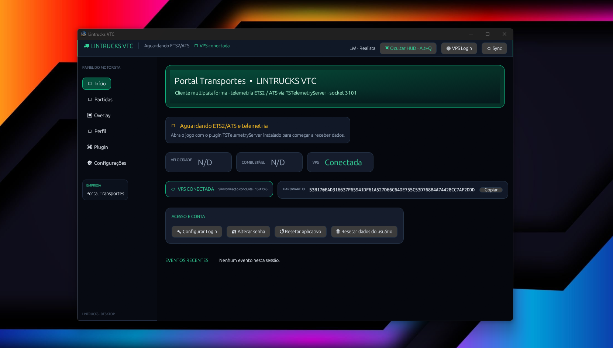

# LinTrucks VTC

Cliente de telemetria para **Euro Truck Simulator 2** e **American Truck Simulator**, com histórico de viagens, sincronização online e HUD.

## Downloads

Baixe os instaladores em **[Releases](https://github.com/eritongrnascimento-svg/LinTrucks-VTC/releases)**. Este repositório distribui os binários; os fontes do VTC são privados e o aplicativo é proprietário. Componentes de terceiros mantêm suas próprias licenças.

- **Windows:** execute o instalador `Setup.exe`.
- **Linux AppImage:** marque o arquivo como executável. Para instalar as dependências, abra um terminal e execute `./Lintrucks-VTC-0.1.0-26-x86_64.AppImage --instalar-dependencias`. Depois abra o AppImage normalmente.
- **Debian/Ubuntu:** instale com `sudo apt install ./Lintrucks-VTC_0.1.0-26_amd64.deb`.

Linux: x86_64, glibc 2.35+, GTK3, OpenGL/EGL e chaveiro Secret Service desbloqueado. AppImage usa bibliotecas do sistema; o assistente reconhece Debian/Ubuntu, Arch, Fedora e openSUSE. Outras bases exigem equivalentes locais. O HUD precisa de X11/XWayland; tela cheia exclusiva e alguns compositores podem limitar a sobreposição.

## Primeiros passos

1. Instale com o jogo e o cliente anterior fechados.
2. Abra o VTC e conclua a autorização do dispositivo com o administrador.
3. Confira o plugin na aba **Plugin**, abra o ETS2/ATS e inicie uma viagem.

## Classes

**Arcade** fica sempre disponível. **Realista** exige combustível realista. **Platina** exige combustível realista, infrações e freios a ar. O limitador é opcional. A classe do perfil pode ser alterada; a viagem iniciada mantém sua classe mesmo com multas ou penalidades.

## Áudios

Saudação ao coletar carga; aviso de combustível abaixo de 50%; bipe ao passar da tolerância; sirene e aviso de multa depois do registro. A regra de mais de 10 segundos contínuos de excesso permanece.

## Atualizações e suporte

Consulte as novas versões em Releases e confira o SHA256 antes de instalar. O cliente não instala atualizações automaticamente. Para o AppImage, o arquivo `.zsync` e os metadados permitem uso com ferramentas compatíveis com AppImageUpdate.

[Portal LinTrucks](https://lintrucks.online) · Feche jogo e cliente antes de atualizar. Os dados e o perfil existentes são reutilizados.
